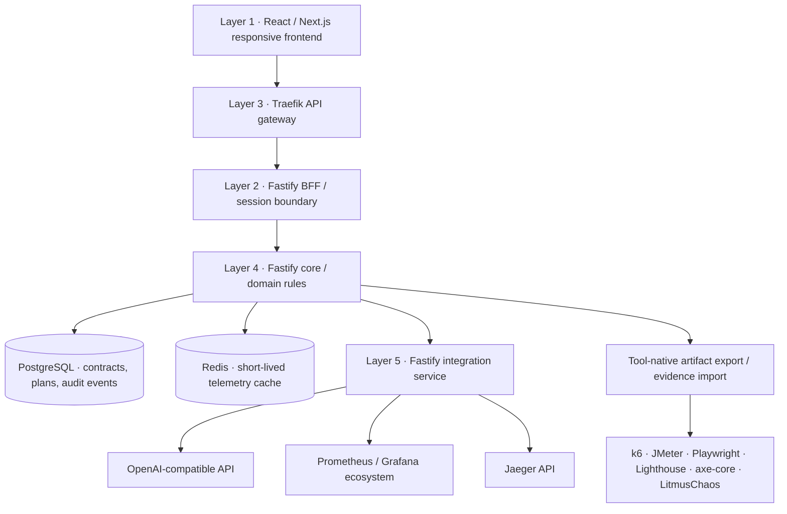

See [workspace organization and engineering rules](docs/architecture/organization.md) for the layer layout, verification commands, and current AI limits.

# Vivegam Quality Lab

A modern non-functional testing portal built around existing open-source tools. The application prepares test artifacts, stores plans, imports evidence, and connects GenAI and telemetry through adapters. It does not replace the tool execution engines.

## Assess before execution

Open **Assessments & reports** to identify missing inputs and risk hypotheses before running tools. Attach a contract or application map, add sanitized requirements, and generate one of seven report types with or without AI. Report content is encrypted and scoped to the workspace. See [connection diagnosis and report requirements](docs/assessment-and-connections.md).

## Architecture



The requested numbering is preserved: frontend → routing/masking → isolation/BFF → core → database and integration adapters. The browser uses only same-origin `/api` routes. Gateway routing hides internal service addresses and removes server-identifying headers; it is not a substitute for data-level PII redaction.

### Selected stack

- **Next.js + React + TypeScript:** responsive desktop/mobile web UI, accessible Radix primitives, independent frontend image.
- **Traefik:** a single ingress, routing, request-size limits and security headers; static configuration avoids giving the gateway access to the Docker socket.
- **Fastify BFF:** signed HttpOnly SameSite cookies, origin validation, login rate limits, stable UI-facing API and OpenAPI docs. Named accounts, revocable sessions, four workspace roles, and enterprise OIDC support multiple workspaces.
- **Fastify core:** contract validation, artifact rules, plan lifecycle, parameterized PostgreSQL queries, transactional plan-create audit, read-through telemetry caching.
- **PostgreSQL:** durable contract metadata, plans, and audit events. **Redis:** disposable 15-second telemetry cache. PostgreSQL is the source of truth.
- **Integration service:** Native Python provider SDK adapters, plus read-only Prometheus and Jaeger adapters. Credentials and external endpoints are configured here only.
- **Prometheus:** scrapes per-service request counts, latency histograms and runtime metrics. Existing Grafana installations can use its data.

No custom load engine, monitoring database, browser automation engine, accessibility scanner or chaos engine is implemented.

## Start locally

Requires Docker Desktop / Docker Compose. Node 24+ is recommended for direct service execution.

```sh
npm ci
npm run setup:local
npm run stack:up
```

Open **http://localhost:8088**. The setup script creates a private `.env` with unique local secrets and preserves any existing `.env`. Open `/login` and use the bootstrap username from `[identity] bootstrap_admin_username` (default `superadmin`) with `SUPER_ADMIN_PASSWORD` from `.env`. Existing installations use the previous `ADMIN_PASSWORD` only for the initial account migration. Startup never overwrites an existing password. Credentials are not bundled into the frontend. To stop: `npm run stack:down` (named database volumes remain intact).

The only published port is gateway port 8088, bound to loopback. PostgreSQL, Redis, BFF, core, adapters, and metrics ports are internal. The service Docker image runs as a non-root user with a read-only root filesystem. The data and backend networks are internal; the integration service has a separate egress network.

## Configure optional connections

Sign in at `/login`, choose a workspace, and open `/settings` as its administrator. Tabs cover AI providers (with individual provider tabs), LangSmith, observability/APM, Git access and testing tool links. Enter the required endpoint, model and credentials in the relevant tab, then save. New requests use saved settings immediately; no service restart is needed.

The environment/config file contains startup infrastructure settings: database/cache connections, server ports, security/session/service secrets, operational limits and `SETTINGS_ENCRYPTION_KEY`. `npm run setup:local` adds the encryption key to an existing local `.env` without replacing credentials. Keep this key stable and back it up separately; losing it makes saved connections unreadable.

Optional connections are encrypted as complete JSON documents using AES-256-GCM with a fresh nonce for every write, stored in PostgreSQL. Both credentials and non-secret configured values are encrypted at rest. The browser receives non-secret values and secret-presence flags; saved secrets are never returned. Internal adapters receive decrypted settings only through a service-token-protected route which is not exposed by the BFF. Settings are isolated by workspace. AES-GCM authenticates both the workspace ID and settings group to prevent ciphertext substitution across workspaces. Only workspace administrators can edit connections.

Configuration-file endpoint defaults are form suggestions. They do not activate optional integrations until a user saves them. AI and telemetry are not required for application startup. Server-managed repository allowlists and resource limits remain in `deployment/configuration.ini`.

See [Python AI service](backend/ai/README.md) for package adapters and tracing behavior.

## Portal workflows

1. Import OpenAPI 3.0–3.2 JSON/YAML. Structural validation checks the document and lists operations; external references are not resolved. Swagger 2.0 must be converted first.
2. Choose operations and open a testing discipline.
3. Tailor and download a tool-native starter, or ask the configured AI provider for a plan/analysis. k6 starters include selected parameter-free GET operations; writes and operations needing fixtures are explicitly omitted.
4. Save drafts. Signed-in plans and contracts persist in PostgreSQL. Anonymous workspaces are disabled. Evidence is analyzed in the backend and not persisted.
5. Run approved artifacts in your existing tools or CI. Import k6 summary-export, axe-core results, or Lighthouse JSON for analysis.
6. Tool installation links and adapter credentials are managed in `/settings` and stored encrypted in the workspace database.

Chaos artifacts are review briefs with required scope, probes, abort and rollback inputs. They do not execute experiments. Automated accessibility scans do not establish WCAG conformance; the toolkit includes manual checks.

## API

After signing in, open `/api/docs` or `/api/openapi.json` through the gateway.

- `POST /api/session`, `GET /api/session`, `DELETE /api/session`
- `GET/POST /api/contracts`
- `GET/POST /api/plans`, `DELETE /api/plans/:id`
- `POST /api/artifacts`, `POST /api/evidence`
- `GET /api/settings`, `PUT /api/settings/:id`
- `GET/POST /api/assistant`
- `POST /api/assistant/test`
- `POST /api/assistant/cursor/agents`, `GET /api/assistant/cursor/agents/:id`
- `GET /api/tools`
- `GET /api/tools/prometheus/summary`, `GET /api/tools/jaeger/services`

Internal calls require a server-only service token. Tool calls are read-only. The gateway and BFF enforce request limits; the core validates domain payloads. Downstream calls have deadlines and redirects disabled. Errors mask upstream exception details from clients. No real secrets are committed.

## Verify

```sh
npm run test:services
npx tsc --noEmit
node scripts/smoke-stack.mjs
```

The smoke test uses generated local credentials without printing them. It creates a small test contract and removes its temporary plan. Unit tests cover JSON/YAML import, excluded mutating operations, evidence formats, adapter authentication, AI request formatting/failure handling, BFF login, CSRF origin checks, and protected APIs.

## Deployment scope

This is a working local Compose deployment and a foundation for production deployment, not a completed multi-tenant SaaS. Before internet exposure, use HTTPS with secure cookies, configure your OIDC identity provider and MFA policies, configure backups and migration rollout, integrate infrastructure secret management, review the operator-managed external-call egress allowlist, and set resource limits for your workload. Direct test execution should use your existing CI/runner with explicit permissions; no runner is enabled here. The frontend is mobile-responsive; no separate native mobile application is included.

The previously registered private Sites identity is retained in `.openai/hosting.json`, but this multi-container architecture is not deployed to Sites. Docker Compose is the active delivery target.

## References

- [Fastify validation](https://fastify.dev/docs/latest/Reference/Validation-and-Serialization/)
- [Traefik providers](https://doc.traefik.io/traefik/reference/install-configuration/providers/overview/)
- [k6](https://grafana.com/docs/k6/latest/)
- [Prometheus queries](https://prometheus.io/docs/prometheus/latest/querying/basics/)
- [OpenTelemetry Collector](https://opentelemetry.io/docs/collector/)
- [Playwright accessibility](https://playwright.dev/docs/accessibility-testing)
- [LitmusChaos](https://docs.litmuschaos.io/)
- [OpenAI Chat API](https://developers.openai.com/api/reference/resources/chat)

## Configuration policy

Operational defaults live in `deployment/configuration.ini`, not in application code. Each INI key can be overridden using its uppercase environment variable (for example, `DEFAULT_P95_MS`, `TELEMETRY_CACHE_SECONDS`, `CORE_URL`). Set `CONFIG_FILE` to choose a different INI file. Missing required values fail explicitly. Startup credentials come from the environment; optional integration credentials are stored encrypted in the database through administrator-only settings. `[public]` is the explicit browser-safe allowlist exposed at `/api/config`; secrets and internal service addresses are never included. Compose and gateway routing files hold deployment topology. Test fixtures and documentation examples are illustrative data, not runtime provider configuration.

## Repository application maps

Open **Application maps** after signing in. Choose an application directory (or individual source files), or supply an HTTPS Git clone URL and optional branch/tag. The portal queues analysis and saves the resulting graph in PostgreSQL. Return to a saved map to see job progress, render the diagram, inspect file-and-line evidence, and export Mermaid (`.mmd`), SVG, or map JSON.

The static path works without GenAI. It reads Docker Compose topology and Traefik upstreams, package manifests, explicit workspace dependencies, and JavaScript/TypeScript relative imports using the TypeScript parser. Other supported language manifests identify component boundaries; their source imports and dynamic aliases are not resolved in this version. Edge labels distinguish startup dependencies, configured endpoints, declared client libraries, package dependencies, and source imports. These relationships are static evidence, not verification of runtime traffic.

**Enrich with AI** sends graph metadata and evidence paths to the configured provider, not raw source contents. AI output must reference existing nodes. Suggested connections remain separate from the original graph and appear as dashed lines. Provider failure or invalid output preserves the original map. A real AI provider remains optional.

### Mapping backend

- The core API enqueues jobs and owns persisted maps.
- `map-worker` claims jobs with PostgreSQL `SKIP LOCKED`, a lease, heartbeat, and fencing token; abandoned jobs can be recovered up to the configured retry limit.
- The integration adapter reads allowlisted HTTPS repositories with a temporary shallow bare clone. Hooks, submodules, credential helpers, redirects, and non-HTTPS Git transports are disabled. It never installs dependencies or runs repository scripts.
- Uploaded source is temporarily present in the queued job and is removed from the active database row on completion or failure. PostgreSQL WAL/backups may retain earlier data according to your database retention policy. The resulting graph stores metadata and evidence, not source bodies.
- Common secrets, dependency folders, build outputs, binary files, and symlinks are excluded. Secret-looking content embedded in an otherwise eligible source file cannot be reliably detected; select an appropriate source scope.
- Repository file limits, timeouts, classification patterns, allowed Git hosts, queue limits, and diagram direction live in `[repository]` in `deployment/configuration.ini` and support uppercase environment overrides. Invalid/oversized inputs are rejected or explicitly marked partial.

For a private Git repository, save its access token in the workspace’s **Git access** settings and set `REPOSITORY_AUTH_HOST` for the single host allowed to receive it. The configured `repository_auth_username` is used for Basic Git authentication. Never put a token in the repository URL. Existing enterprise Git hosts can be added to the host allowlist by an administrator; local/IP-address destinations are rejected.

New API routes:

- `GET /api/maps/config`
- `GET /api/maps`, `POST /api/maps`
- `GET /api/maps/:id`
- `POST /api/maps/:id/enrich`

The core and worker apply a transactional, advisory-locked startup migration for the mapping table, including existing installations. `docker compose up --build -d` adds the worker and preserves existing database volumes.

Run `node scripts/smoke-mapping.mjs` for the folder-import workflow, or supply an allowed public Git URL as its first argument to exercise a live Git import. The smoke test saves clearly named example maps for inspection. Unit tests cover topology extraction, evidence, path/resource validation, secret exclusions, Git URL policy, AI schema validation, and worker completion/failure behavior.


## Identity and workspace authorization

- `/login`: local username/password or enterprise OpenID Connect SSO.
- `/account`: change a local password; successful changes revoke other sessions. Temporary passwords must be changed before workspace APIs can be used.
- `/admin`: create workspaces/users, assign workspace roles, disable accounts, review access audits, and configure SSO (platform administrator only).
- Roles are `viewer`, `developer`, `tester`, and `admin`. Viewer is read-only; developer/tester prepare testing artifacts and use AI; repository coding agents require developer/admin; connection and membership management require admin. Platform administration is a protected bootstrap account capability, never assigned by an SSO claim or normal membership update.
- Every enrolled user receives viewer access to the default workspace. Additional memberships are explicit. Keep default workspace content suitable for all users.
- Passwords use salted Argon2id. Session cookies are HttpOnly/SameSite=Lax; the database stores token hashes, absolute/idle expiry, and a credential version. CSRF tokens and origin checks protect writes. Disabling accounts, removing memberships, changing passwords, and logout invalidate relevant sessions. The last active workspace administrator cannot be removed or disabled.
- Bootstrap credentials are infrastructure inputs: `SUPER_ADMIN_PASSWORD` and `[identity] bootstrap_admin_username`; `SUPER_ADMIN_USERNAME` can override the username in Compose. Initial seeding runs once. Changing the environment password later does not reset a stored account.

SSO uses authorization code + PKCE, state, nonce, issuer/audience/expiry checks and JWKS signature verification through `openid-client`. Flow secrets and IdP credentials are encrypted server-side. Configure an HTTPS issuer, client ID/secret and the exact displayed callback URL. `AUTH_PUBLIC_URL` must match your canonical portal origin; non-local deployments require HTTPS and `COOKIE_SECURE=true`. JIT enrollment requires an explicitly allowed email domain and an `email_verified=true` claim. Existing SSO identities are matched by issuer and subject, never auto-linked to local accounts by email. MFA and conditional access remain in your existing IdP.

## Backend security boundary

The frontend has no database client, credentials, parsing engine, artifact generator, evidence analyzer, repository analyzer, AI provider SDK or authorization engine. It renders public DTOs and submits user inputs to the BFF. Client button visibility is presentation; the backend independently authorizes and validates each operation. The BFF forwards only allowlisted routes. Core SQL queries always constrain workspace IDs; internal adapters cannot obtain runtime credentials without a validated workspace context.

Backend egress destinations are controlled by `[egress] allowed_hosts` and `http_hosts` in the startup configuration (or matching environment overrides). Add approved custom AI, telemetry and OIDC hosts there before saving connections. SDK transports reject unapproved destinations and redirects, enforce HTTPS except explicitly approved local services, and bound AI response sizes. Git has its own host, DNS/address, file and resource restrictions. Logs exclude request query strings and raw upstream errors. CSP, framing, MIME, referrer and browser permission policies cover UI delivery.

Additional verification:

```sh
backend/ai/.venv/bin/python -m unittest discover -s tests -p 'test_ai.py' -v
docker compose exec -T core node --input-type=module < tests/identity-postgres.mjs
```

The PostgreSQL suite uses an isolated schema and drops only that test schema. It verifies password changes, session revocation, role enforcement and workspace isolation. A successful local test is not a production security certification; configure your real IdP, HTTPS, backups, deployment secrets and infrastructure monitoring before public use.
